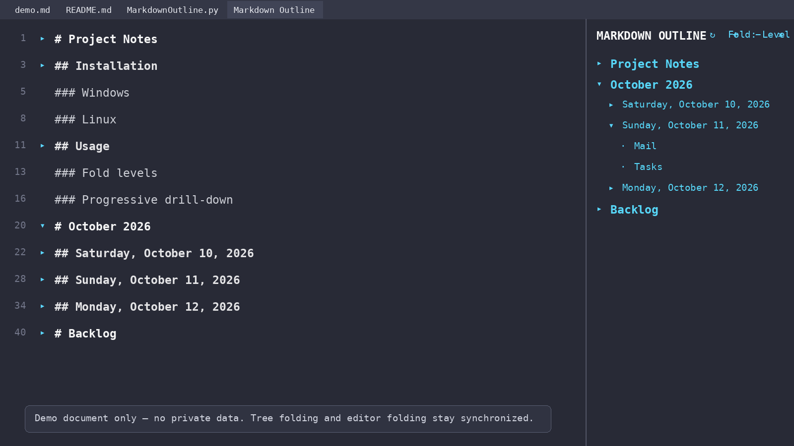
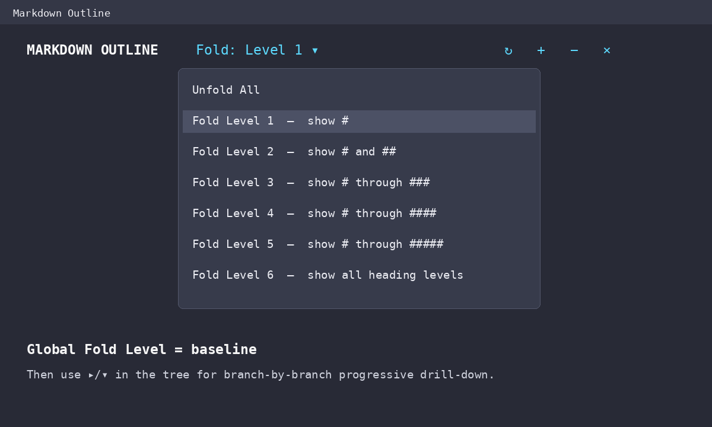

# Markdown Outline for Sublime Text

A lightweight Markdown outline panel for **Sublime Text 4** with synchronized editor folding, global fold levels, and branch-by-branch progressive drill-down.



## Features

- Builds a right-side outline from Markdown ATX headings (`#` through `######`).
- Click a heading title to jump to that heading in the editor.
- Use **Fold Level 1–6** as a global baseline.
- Expand only the branch you need with **progressive drill-down**.
- Keeps outline folding and Markdown editor folding synchronized for outline-driven actions.
- Normal typing and editing do **not** automatically refold the document.
- Ignores ATX-looking headings inside fenced code blocks.
- Keeps MarkdownOutline's own folds separate from unrelated/manual folds.
- Includes commands for refresh, unfold all, fold level 1, and close.

## Requirements

- Sublime Text 4.
- A Markdown file using ATX headings such as `# Heading`, `## Heading`, etc.
- No dependency on MarkdownEditing or the old third-party Outline package.

## Installation

### Manual package install

1. In Sublime Text choose **Preferences → Browse Packages…**.
2. Close Sublime Text.
3. If you used an older development version, remove or rename these two files from `Packages/User/`:
   - `MarkdownOutline.py`
   - `MarkdownOutline.sublime-commands`
4. Copy this repository folder into the Packages directory and name the folder:
   `MarkdownOutline`
5. Start Sublime Text again.
6. Open a Markdown file.
7. Press `Ctrl+Shift+P`.
8. Run **Markdown Outline: Show Right**.

On Windows the final folder will normally look like:

```text
C:\Users\<you>\AppData\Roaming\Sublime Text\Packages\MarkdownOutline\
    MarkdownOutline.py
    Default.sublime-commands
    Main.sublime-menu
    README.md
    ...
```

A Dutch installation guide is also included in [`INSTALL-NL.md`](INSTALL-NL.md).

## Using the outline

The toolbar looks like this:

```text
MARKDOWN OUTLINE    Fold: Level 1 ▾    ↻   +   −   ×
```

| Control | Meaning |
|---|---|
| `Fold: Level N ▾` | Select the global Markdown fold level |
| `↻` | Refresh the outline |
| `+` | Unfold all |
| `−` | Fold to Level 1 |
| `×` | Close the outline |
| `▸ / ▾` | Expand/collapse only that branch |
| heading text | Jump to that heading in the editor |

### Global fold levels

The selected fold level is the baseline for the whole document.

For example, **Fold Level 1** shows only `#` headings. **Fold Level 2** shows `#` and `##`, and so on.



### Progressive drill-down

Suppose your document contains:

```markdown
# October 2026

## Saturday, October 10, 2026
### Mail
### Tasks

## Sunday, October 11, 2026
### Mail
### Tasks

## Monday, October 12, 2026
### Mail
### Tasks
```

With **Fold Level 1**, only `October 2026` is part of the global baseline.

Click the triangle next to `October 2026` and only that branch reveals the next structural level. Other Level-1 branches stay closed.

Then click the triangle next to `Sunday, October 11, 2026` and only Sunday's direct child headings appear. This is the progressive drill-down model: **global baseline + local branch expansion**.

Click the same triangle again to collapse only that branch.

## Commands

All commands are available through the Command Palette (`Ctrl+Shift+P`):

```text
Markdown Outline: Show Right
Markdown Outline: Fold Menu
Markdown Outline: Fold Level 1
Markdown Outline: Fold Level 2
Markdown Outline: Fold Level 3
Markdown Outline: Fold Level 4
Markdown Outline: Fold Level 5
Markdown Outline: Fold Level 6
Markdown Outline: Unfold All
Markdown Outline: Refresh
Markdown Outline: Close
```

There is also a **Tools → Markdown Outline** menu.

## How it works

MarkdownOutline parses ATX headings from the active Markdown buffer and builds a parent/child tree from heading levels.

The outline itself is rendered as a Sublime HTML sheet in a second editor group. It is not the native Sublime sidebar.

The plugin maintains two folding concepts:

1. **Global Fold Level** — the baseline visibility for the document.
2. **Local branch state** — explicit branch expansions/collapses layered on top of that baseline.

For outline-driven folding, the plugin calculates which headings should remain visible and creates managed editor fold regions between those boundaries. Those regions are tracked separately so MarkdownOutline can remove/rebuild its own folds without indiscriminately unfolding the whole document.

Typing does not rebuild those folds. The outline text can refresh after editing, but folding only changes after an explicit outline/fold command.

## Markdown parsing rules

Supported:

```markdown
# H1
## H2
### H3
#### H4
##### H5
###### H6
```

Optional closing hashes are accepted:

```markdown
## Heading ##
```

Headings inside fenced blocks are ignored:

````markdown
```text
# This is not treated as a heading
```
````

## Current limitations

- ATX headings are supported; Setext-style headings are not currently parsed.
- The outline expects a single editor group when it is first opened.
- Fold/expand state is kept in memory and resets when Sublime Text restarts.
- Outline-driven folds are synchronized to the editor. Native/manual editor folding is still primarily controlled by Sublime itself and is not treated as the authoritative outline state.
- This repository is not yet published through Package Control; installation is manual or via Git clone.

## Development history

Version **1.0.0** is the first GitHub-ready release. It includes:

- global Fold Level 1–6;
- progressive branch drill-down;
- editor-safe folding while typing;
- stable structural node identity across line-number changes;
- corrected fold ownership at adjacent sibling headings;
- managed fold regions that do not require globally unfolding the entire buffer.

See [`CHANGELOG.md`](CHANGELOG.md).

## License

MIT. See [`LICENSE`](LICENSE).

## Disclaimer

This is an independent Sublime Text plugin and is not affiliated with Sublime HQ Pty Ltd.
